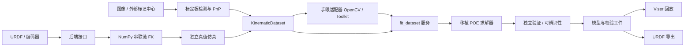

# KinematicCalibration

独立于 DexSim 的机器人运动学标定工具。直接移植 RobotKineCal 的 POE 轴几何求解器和
`auto_calibrate_sim` 的数据、验证、零偏、URDF 导出流程，提供 NumPy 无界面后端、Viser
浏览器回放、可复用标定板与手眼标定适配器。

## 快速运行

Python 3.10–3.12；基础流程无需 GPU、ROS、DexSim 或 Robotics Toolbox。

```bash
git clone --recurse-submodules https://github.com/chase6305/KinematicCalibration.git
cd KinematicCalibration
uv venv .venv --python 3.11
uv pip install --python .venv/bin/python -e '.[dev,vision,visualization]'
source .venv/bin/activate

# 独立真值几何 + 带噪声测量 + 训练 + 留出验证
kincal demo --samples 100 --validation-samples 40 --output outputs/ur10

# 浏览器打开终端显示的地址；滑块切换独立验证姿态
kincal view outputs/ur10
kincal inspect outputs/ur10

# 图像闭环：渲染旧圆板 PNG、实际检测/PnP、拟合、独立留出验证
kincal image-demo --output outputs/image-demo
kincal view outputs/image-demo
```

已有仓库只需 `git submodule update --init --recursive`。子模块源码与构建是独立步骤，基础
运动学标定和 OpenCV 手眼标定不需要编译它。Viser 默认监听 `127.0.0.1:8080`，远程访问可
使用 SSH 端口转发或显式 `--host 0.0.0.0`。

示例结果（seed=42，50 个训练姿态 / 20 个独立验证姿态，0.1 mm 平移噪声、0.0002 rad
旋转噪声）：位置 RMSE **9.324 → 0.219 mm**，4 次迭代，回归矩阵秩 30/30。
这是合成位姿传感器实验，未模拟相机可见性、碰撞或动力学，不能据此推断实机精度。

## 架构



| 模块 | 职责 |
| --- | --- |
| `robotkinecal` | 原求解器 API；新增 `from_screw_axes`，不强制引入 RTB |
| `kinematic_calib` | 兼容迁移的数据和 CLI、内存拟合服务、独立验证、来源校验、URDF 导出 |
| `kinematic_calibration.backends` | `KinematicsBackend` 协议、NumPy URDF FK、可选 Viser |
| `kinematic_calibration.targets` | 标定板尺寸、坐标、资源、图像检测和 PnP |
| `kinematic_calibration.handeye` | OpenCV / HandEyeCalibrationToolkit 的统一接口 |
| `kinematic_calibration.experiment` | 可复现实验、留出数据、可迁移且带哈希的结果 |
| `kinematic_calibration.image_simulation` | 图像渲染、检测测量、独立图像验证和完整工件检查 |
| `kinematic_calibration.acquisition` | 图像/中心、编码器、同步和质量报告的离线导入 |
| `third_party/HandEyeCalibrationToolkit` | 固定版本 Git 子模块；单独构建原生检测/标定能力 |

所有变换用 `A_T_B` 表示将 B 中的坐标变到 A；长度为米，角度为弧度；螺旋轴排列为
`[v_x,v_y,v_z,w_x,w_y,w_z]`。基础 URDF 后端支持 fixed/revolute/continuous 的指定串联路径，
明确拒绝 mimic 和 prismatic。任意旋转轴和固定工具变换均参与 FK。

## 使用已有数据与 URDF

数据格式是无 pickle 的 NPZ：`joint_positions[N,DOF]`、`observed_poses[N,4,4]`、
`observation_frame`（`base_T_ee` 或 `camera_T_target`）、`sample_indices[N]`、`schema_version`、
新版 `joint_names[DOF]`。名称按序与 URDF 匹配，旧无名数据会明确标记列身份未验证。
请使用真实编码器和独立传感器观测；以名义模型 FK 充当测量无法验证运动学误差。

无 RTB 路线可以直接拟合 POE 并保存带来源校验的工件：

```bash
kinematic-calib solve --backend numpy --dataset train.npz --urdf robot.urdf \
  --ee-name tool_link --model-mode robot-body --output outputs/fit.npz
kinematic-calib validate-result --parameters outputs/fit.npz \
  --dataset validation.npz --output outputs/validation.json

# 统一入口也支持无 RTB 的几何拟合、工件复核及汇总
kinematic-calib calibrate --backend numpy --calibration-type geometry \
  --dataset train.npz --urdf robot.urdf --ee-name tool_link \
  --output-dir outputs/calibration --skip-handeye
```

`--backend numpy` 支持指定 `--base-link`、已知相机外参及复合模型；结果用于预测和独立
验证，不包含物理 joint origin，因此明确不允许通过该路线导出 URDF。
统一入口会在结果中注明跳过导出的原因；零偏和 `both` 阶段仍使用可选 RTB 适配器。

完整迁移的 URDF 工作流使用可选 RTB 模型适配器：

```bash
uv pip install --python .venv/bin/python -e '.[robotics]'
kinematic-calib inspect --dataset captures.npz
kinematic-calib calibrate --dataset captures.npz --urdf robot.urdf \
  --ee-name tool_link --output-dir outputs/calibration --calibration-type geometry
kinematic-calib --help
```

`base_T_ee` 数据直接求解机器人几何；相机观测可配合已验证的手眼结果转换到机器人坐标。
相机与工具外参均未知时求解的是 Camera/Target 复合模型：端点预测可验证，但首关节、
工具及外参的自由度无法分别唯一归因，不能把复合模型直接视为完整物理 URDF。
零偏与几何的联合归因有额外可辨识性限制，实验性 gauge 分配保持显式选择。

也可以完全不依赖 RTB，直接使用后端与内存拟合服务：

```python
from kinematic_calibration.backends import NumpyBackend
from kinematic_calib import KinematicDataset, fit_dataset
from robotkinecal import SerialRobotKineCal

robot = NumpyBackend.from_urdf("robot.urdf", end_link="tool_link")
axes, home = robot.poe_parameters()
solver = SerialRobotKineCal.from_screw_axes(axes, home, joint_names=robot.joint_names)
fit = fit_dataset(KinematicDataset.load("base_ee_observations.npz"), solver)
# fit.screw_axes / fit.zero_pose 是拟合后的 POE；部署前另用未参与拟合的数据验证。
```

## 标定板与手眼标定

保留本地参考的多 CCTag、单 CCTag、OpenCV 非对称圆板的 SVG、PNG、带纹理 OBJ。
板尺寸、行距、OBJ 和检测坐标转换均显式描述。旧 CCTag artwork 与工具包新版编码样式
存在版本差异，默认检测会拒绝隐式混用；已有旧检测中心可直接用于 PnP。
见 [标定板与手眼说明](docs/boards-and-handeye.md)。
固定子模块的源码构建、CTest 和本地安装见 [原生构建](docs/native-build.md)。

## 采集导入与姿态选择

```bash
# 示例含两帧合成投影中心，仅用于检查格式，样本量不足以求解六轴机器人
kincal import-captures examples/captures.example.json --output outputs/captures.npz
kinematic-calib verify-collection --dataset outputs/captures.npz \
  --report outputs/captures.report.json

# 选择多个标定姿态，再缩短这些姿态的访问路径
kincal plan --count 40 --candidates 400 --output outputs/pose-plan.npz

# 指定六轴起始关节角，最后返回起点；角度单位为弧度
kincal plan --count 40 --start-joints 0 0 0 0 0 0 --return-to-start \
  --output outputs/pose-plan-round-trip.npz
```

采集 manifest 包含内参、畸变、板类型、关节顺序、关节/图像时间戳，以及图像路径或按
`board.points` 排列的像素点。默认时间差不超过 0.03 s、重投影 RMS 不超过 2 px，并拒绝
检测到的平面姿态歧义。错误帧会记录原因；默认整批失败，只有显式 `--allow-partial` 才
输出剩余帧。报告保存为 `captures.report.json`，含逐帧质量和数据哈希。
`verify-collection` 复核数据与导入报告的一致性，不重新检测源图像。

姿态选择基于解析回归矩阵做贪心 D-optimal 选择，报告未正则化的秩/条件数；
`--characteristic-length-m` 指定平移/旋转的尺度。随后以关节角欧氏距离做最近邻与 2-opt
排序，保证总距离不长于原选姿顺序，但不保证全局最短。没有指定起点时，从首个选中姿态
出发；`--start-joints` 按 URDF 关节列顺序提供，`--return-to-start` 要求明确起点。
距离按原始弧度计算，不隐式绕过 ±π，也不代表执行时间。

计划 NPZ schema 2 中，`planned_joint_positions` 按访问顺序排列；`candidate_indices`
指向原候选行，`selected_candidate_indices` 保留 D-optimal 选姿顺序，`visit_order` 是两者
之间的排列。另存关节名称、限位、每段距离及元数据。起始配置和可选回程记录在元数据与
距离中，不额外算作标定姿态。输出尚未做碰撞或相机可见性检查，也不生成带速度约束的轨迹。
完整的无 DexSim 示例见 [planned_calibration.py](examples/planned_calibration.py)：按计划顺序
从独立扰动真值模型生成合成观测，再拟合并用另一批关节配置验证。

## 验证与开发

```bash
# 共享工作区可能注入 ROS 的 pytest 插件，因此隔离第三方自动插件
env -u PYTHONPATH PYTEST_DISABLE_PLUGIN_AUTOLOAD=1 .venv/bin/python -m pytest -q
.venv/bin/ruff check src tests scripts benchmarks
.venv/bin/python -m build
```

可选原生 Toolkit 与 RTB 集成测试会在缺依赖时跳过；基础数值、数据、板几何、OpenCV
测试仍执行。`outputs/` 为生成结果目录，不纳入版本控制。实验结果含独立训练/验证数据、
校准 POE、名义 URDF、rank/condition/convergence 诊断、指标与哈希 manifest；移动整个
目录仍可加载。`accepted` 仅代表声明的合成实验诊断范围，不等于实机部署验收。

来源和本地改动见 [移植记录](docs/porting.md) 与 [架构说明](docs/architecture.md)。
另见 [图像实验](docs/image-experiment.md)、[数据契约](docs/data-contract.md)、
[数值约定](docs/numerics.md)、[实测性能](docs/performance.md) 和 [优化记录](docs/worklog.md)。
