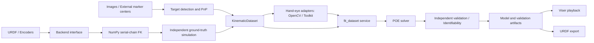

# KinematicCalibration

English | [简体中文](README.zh-CN.md)

A robot kinematic calibration toolkit for POE axis geometry estimation, joint offset
calibration, independent validation, and URDF export. It provides a headless NumPy
backend, Viser browser playback, reusable calibration targets, and hand-eye calibration adapters.

## Quick start

Python 3.10–3.12. The basic workflow requires no GPU, ROS, or Robotics Toolbox.

```bash
git clone --recurse-submodules https://github.com/chase6305/KinematicCalibration.git
cd KinematicCalibration
uv venv .venv --python 3.11
uv pip install --python .venv/bin/python -e '.[dev,vision,visualization]'
source .venv/bin/activate

# Independent ground-truth geometry, noisy measurements, fitting, and held-out validation
kincal demo --samples 100 --validation-samples 40 --output outputs/ur10

# Open the URL printed in the terminal; use the slider to inspect held-out poses
kincal view outputs/ur10
kincal inspect outputs/ur10

# Image pipeline: render legacy circle-board PNGs, detect/PnP, fit, and validate on held-out images
kincal image-demo --output outputs/image-demo
kincal view outputs/image-demo
```

For an existing checkout, run `git submodule update --init --recursive`. Fetching the
submodule source and building it are separate steps; basic kinematic calibration and
OpenCV hand-eye calibration do not require a native build. Viser listens on
`127.0.0.1:8080` by default. For remote access, use SSH port forwarding or explicitly
set `--host 0.0.0.0`.

Example result (seed=42, 50 training poses / 20 independent validation poses,
0.1 mm translation noise, 0.0002 rad rotation noise): position RMSE
**9.324 → 0.219 mm**, 4 iterations, regression matrix rank 30/30.
This is a synthetic pose-sensor experiment without camera visibility, collision, or
dynamics modeling; it does not establish real-robot accuracy.

## Architecture



| Module | Responsibility |
| --- | --- |
| `robotkinecal` | POE axis geometry solver; supports `from_screw_axes` without requiring RTB |
| `kinematic_calib` | Data contracts and CLI, in-memory fitting, independent validation, provenance checks, and URDF export |
| `kinematic_calibration.backends` | `KinematicsBackend` protocol, NumPy URDF FK, and optional Viser |
| `kinematic_calibration.targets` | Target dimensions, coordinates, assets, image detection, and PnP |
| `kinematic_calibration.handeye` | Unified OpenCV / HandEyeCalibrationToolkit interface |
| `kinematic_calibration.experiment` | Reproducible experiments, held-out data, and portable results with hashes |
| `kinematic_calibration.image_simulation` | Image rendering, detection-based measurements, independent image validation, and complete artifact checks |
| `kinematic_calibration.acquisition` | Offline import of images/centers, encoders, synchronization, and quality reports |
| `third_party/HandEyeCalibrationToolkit` | Pinned Git submodule; native detection/calibration capabilities built separately |

Transforms use `A_T_B` to map coordinates from B into A. Lengths are in metres and
angles in radians. Screw axes use `[v_x,v_y,v_z,w_x,w_y,w_z]` ordering. The basic
URDF backend supports a selected serial path with fixed/revolute/continuous joints
and explicitly rejects mimic and prismatic joints. Arbitrary rotation axes and fixed
tool transforms participate in FK.

## Using existing data and URDFs

Datasets use pickle-free NPZ files containing `joint_positions[N,DOF]`,
`observed_poses[N,4,4]`, `observation_frame` (`base_T_ee` or `camera_T_target`),
`sample_indices[N]`, `schema_version`, and, in newer files, `joint_names[DOF]`.
Joint names must match the URDF order; legacy unnamed data is explicitly marked as
having unverified column identities. Use real encoder readings and independent sensor
observations: nominal-model FK used as a measurement cannot validate kinematic errors.

Fit POE parameters and save artifacts with provenance checks without RTB:

```bash
kinematic-calib solve --backend numpy --dataset train.npz --urdf robot.urdf \
  --ee-name tool_link --model-mode robot-body --output outputs/fit.npz
kinematic-calib validate-result --parameters outputs/fit.npz \
  --dataset validation.npz --output outputs/validation.json
kincal view-fit --parameters outputs/fit.npz --dataset validation.npz \
  --urdf robot.urdf

# The unified entry point also supports geometry fitting, artifact checks, and summaries without RTB
kinematic-calib calibrate --backend numpy --calibration-type geometry \
  --dataset train.npz --urdf robot.urdf --ee-name tool_link \
  --output-dir outputs/calibration --skip-handeye
```

`--backend numpy` supports `--base-link`, known camera extrinsics, and composite
models. Results support prediction and independent validation but do not contain
physical joint origins, so URDF export is explicitly disallowed for this workflow.
The unified entry point records why export was skipped; offset and `both` stages
still use the optional RTB adapter. Playback of existing artifacts does not construct
a ground-truth model. See [Measured-data playback](docs/measured-playback.md) for
camera frames, fixed extrinsics, and sample labels.

Solver and report commands reject input/output path conflicts, even with `--force`.
Fitted parameters and the JSON report are published only after both are ready;
ordinary write failures or Python interruptions restore the original pair. A process
crash may leave an incomplete pair, which hash checks reject when loading.

The URDF calibration and export workflow uses the optional RTB model adapter:

```bash
uv pip install --python .venv/bin/python -e '.[robotics]'
kinematic-calib inspect --dataset captures.npz
kinematic-calib calibrate --dataset captures.npz --urdf robot.urdf \
  --ee-name tool_link --output-dir outputs/calibration --calibration-type geometry
kinematic-calib --help
```

RTB origin export has limitations for fixed paths between joints and the trailing tool
chain; see [Architecture](docs/architecture.md). NumPy POE fitting and validation
support fixed transforms along the selected path.

`base_T_ee` data directly estimates robot geometry. Camera observations can be
converted into the robot frame using validated hand-eye results. When both camera and
tool extrinsics are unknown, the solver estimates a Camera/Target composite model:
endpoint predictions can be validated, but the degrees of freedom of the first joint,
tool, and extrinsics cannot be uniquely attributed separately. A composite model is
therefore not a complete physical URDF. Joint attribution of offsets and geometry has
additional identifiability limits; experimental gauge allocation remains an explicit choice.

You can also use the backend and in-memory fitting service directly without RTB:

```python
from kinematic_calibration.backends import NumpyBackend
from kinematic_calib import KinematicDataset, fit_dataset
from robotkinecal import SerialRobotKineCal

robot = NumpyBackend.from_urdf("robot.urdf", end_link="tool_link")
axes, home = robot.poe_parameters()
solver = SerialRobotKineCal.from_screw_axes(axes, home, joint_names=robot.joint_names)
fit = fit_dataset(KinematicDataset.load("base_ee_observations.npz"), solver)
# fit.screw_axes / fit.zero_pose contain the fitted POE; validate on unused data before deployment.
```

## Calibration targets and hand-eye calibration

Assets include SVG, PNG, and textured OBJ files for multi-CCTag, single-CCTag, and
OpenCV asymmetric circle boards based on local references. Board dimensions, row
spacing, and OBJ/detection coordinate conversions are described explicitly. Legacy
CCTag artwork differs from the toolkit's newer encoding style; default detection
rejects implicit mixing of these versions. Existing legacy detection centers can be
used directly for PnP. See [Targets and hand-eye calibration](docs/boards-and-handeye.md).
For source builds, CTest, and local installation of the pinned submodule, see
[Native build](docs/native-build.md).

## Capture import and pose selection

```bash
# Two frames of synthetic projected centers for format checks; insufficient for a six-axis solve
kincal import-captures examples/captures.example.json --output outputs/captures.npz
kinematic-calib verify-collection --dataset outputs/captures.npz \
  --report outputs/captures.report.json

# Select calibration poses, then shorten their visit path
kincal plan --count 40 --candidates 400 --output outputs/pose-plan.npz

# Specify a six-axis starting configuration and return to it; angles are in radians
kincal plan --count 40 --start-joints 0 0 0 0 0 0 --return-to-start \
  --output outputs/pose-plan-round-trip.npz

# Visit an existing set of configurations; .npy files containing only an [N,DOF] array also work
kincal plan --input-joints chosen-poses.npz --output outputs/chosen-plan.npz

# Specify a count only when selecting a subset
kincal plan --input-joints candidate-poses.npz --count 20 \
  --output outputs/selected-plan.npz

# Generate synthetic observations from independently perturbed ground truth in saved visit order, then fit
kincal demo --plan outputs/pose-plan-round-trip.npz --output outputs/planned-demo
kincal view outputs/planned-demo --split training
kincal view outputs/planned-demo  # Independent validation set
```

The capture manifest contains intrinsics, distortion, board type, joint order,
joint/image timestamps, and image paths or pixel points ordered by `board.points`.
By default, the timestamp difference must not exceed 0.03 s and reprojection RMS must
not exceed 2 px; detected planar pose ambiguity is rejected. Invalid frames receive
recorded reasons. The whole batch fails by default; only explicit `--allow-partial`
writes the remaining frames. `captures.report.json` contains per-frame quality and
data hashes. `verify-collection` checks consistency between the data and import
report without detecting the source images again.

Pose selection uses greedy D-optimal selection on the analytical regression matrix
and reports unregularized rank/condition numbers. `--characteristic-length-m` sets
the translation/rotation scale. Nearest-neighbor and 2-opt ordering then use Euclidean
distance in joint angles, ensuring a total distance no longer than the original
selection order without guaranteeing a global minimum. Without a specified start,
the path begins at the first selected pose. Supply `--start-joints` in URDF joint
column order; `--return-to-start` requires an explicit start. Distances use raw radians,
do not implicitly wrap across ±π, and do not represent execution time.

`--input-joints` accepts an NPY array or an NPZ containing `joint_positions[N,DOF]`
in radians. NPZ files may include column-ordered `joint_names` and original
`sample_indices`; existing datasets also work, and planning does not read their
observed poses. Names, when present, must exactly match the URDF chain. Unnamed
inputs are interpreted in URDF joint order and marked as having unverified column
identities. By default, every row is visited and duplicate configurations retain
separate row identities; D-optimal selection runs only with a smaller `--count`.
Small or underdetermined sets can be ordered successfully, while fitting still checks
sample count and observability.

In plan NPZ schema 2, `planned_joint_positions` follows visit order;
`candidate_indices` points to original candidate rows; `selected_candidate_indices`
retains D-optimal selection order; and `visit_order` is the permutation between them.
Joint names, limits, segment distances, and metadata are also saved. The starting
configuration and optional return segment appear in metadata and distances, rather
than as additional calibration poses. Plans have no collision or camera visibility
checks and do not generate velocity-constrained trajectories. When an input file is
provided, its hash is saved; original capture IDs are stored as `source_sample_indices`
and do not replace candidate row indices.
`demo --plan` verifies the same nominal URDF, joint columns, limits, and frame chain,
and samples in plan row order; it cannot be combined with `--samples`. The full plan
is archived with the experiment, preserving the mapping between training rows and
candidate IDs. `view --split training` shows training poses and errors; default `view`
continues to show the independent validation set. See
[planned_calibration.py](examples/planned_calibration.py) for a complete example that
generates observations in plan order, archives fitted results, and validates with a
separate set of joint configurations. Archived directories can also be replayed in Viser.

## Validation and development

```bash
# Isolate automatically loaded third-party pytest plugins, including ROS plugins in shared workspaces
env -u PYTHONPATH PYTEST_DISABLE_PLUGIN_AUTOLOAD=1 .venv/bin/python -m pytest -q
.venv/bin/ruff check src tests scripts benchmarks
.venv/bin/python -m build
```

Optional native Toolkit and RTB integration tests are skipped when dependencies are
missing; core numerical, data, target geometry, and OpenCV tests still run. Generated
results belong in `outputs/`, which is excluded from version control. Experiment
results contain independent training/validation data, calibrated POE parameters,
nominal URDF, rank/condition/convergence diagnostics, metrics, and a manifest with
hashes; moving the whole directory preserves loadability. `accepted` applies only to
the declared synthetic experiment diagnostics and does not constitute real-robot
deployment acceptance.

For design details, see [Architecture](docs/architecture.md). Also see
[Image experiments](docs/image-experiment.md), [Data contract](docs/data-contract.md),
[Numerical conventions](docs/numerics.md), [Measured performance](docs/performance.md),
and [Optimization notes](docs/worklog.md).
