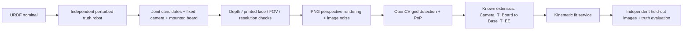

# 无 DexSim 的图像端到端运动学标定实验

此实验从现有标定板 PNG 生成真实 RGB 图像，用 OpenCV 检测板并执行 PnP，再用独立已知外参恢复末端测量位姿，调用同一运动学拟合服务。训练数据中的测量位姿来自图像检测结果；理想 FK 只用于生成图像和另存的真值评估。



## 运行

```bash
python -m pip install -e '.[vision]'
python examples/image_calibration.py --output runs/image-example
```

默认使用 UR10、50 个训练图像和 20 个独立留出图像。输出目录须不存在或为空，实验完成后才将完整目录发布到该位置。可重复运行时使用不同目录；相同种子、配置、算法版本产生相同的关节候选和图像噪声流。

```python
from kinematic_calibration.image_simulation import ImageCamera, ImageNoise, run_image_experiment

report = run_image_experiment(
    "runs/image-custom",
    samples=50,
    validation_samples=20,
    seed=42,
    camera=ImageCamera(width=1280, height=960, focal_length_px=1100),
    noise=ImageNoise(rgb_std=0.5, blur_sigma_px=0.3, supersample=2),
)
```

可以传入 `urdf`、`base_link`、`end_link`、`board`、`base_t_camera` 和 `ee_t_board`。默认相机位姿适用于示例 UR10 的部分工作空间；不同机器人或装夹需要选择合适的固定相机和安装变换。若在 `max_candidates` 次候选内没有收集到足够样本，实验明确失败并报告拒绝原因，不会用理想位姿补齐数据。

## 图像形成与几何约定

`Base_T_Camera` 映射光学相机坐标系到机器人基座，`EE_T_Board` 映射板坐标系到末端。相机 X 向右、Y 向下、Z 向前；板 X 向打印图案右侧、Y 向下、Z 指向打印面内部。板原点仍为第一个检测控制点。测量转换为：

```text
Camera_T_Board_truth = inverse(Base_T_Camera) @ FK_truth(q) @ EE_T_Board
Base_T_EE_measured = Base_T_Camera @ Camera_T_Board_detected @ inverse(EE_T_Board)
```

渲染使用现有 PNG 纹理和板的米制平面几何，通过针孔单应性投影形成图像。原圆板 PNG 的像素宽高经过整数取整，直接把像素边界当成精确物理尺寸会引入小的尺度偏差。加载纹理时，先从该固定 PNG 检测完整圆心网格，并与已知米制控制点做一次静态注册，记录注册残差；随后每帧仍独立渲染、加噪声并重新检测。注册后的纹理边界必须与声明的板尺寸、原点在 1 mm 内一致。

图像模型包含可配置的超采样、Gaussian blur 和 RGB 强度 Gaussian 噪声，不向检测输出位姿额外添加理想化噪声。超采样与 `INTER_AREA` 降采样保持相机像素中心对齐。镜头畸变固定为零。

采样先检查整块板的正深度、完整视野、打印面方向和投影控制点间距；过于接近正视或掠视的视角不进入渲染。实际检测之后仍检查重投影 RMS 和平面位姿双解歧义。各关节在模型限位内采样；此处不进行碰撞检查。

训练和验证分别使用独立随机流，保留不相交样本 ID。真值机器人和已知外参在两组数据中保持相同，符合对同一台机器收集独立位姿的实验。报告分别给出测量与真值、模型与测量、模型与真值的误差，避免把像素残差、闭环误差和真实末端误差混用。

## 板选择及 CCTag 模式

默认 `opencv-acircle` 使用 OpenCV 图像检测。`kincal image-demo` 也支持独立的
`cctag-multi-v3` 板与显式 `--detector-backend toolkit`：原生解码器先注册源 PNG
的标记 ID，再逐张检测渲染后的 RGB 图像，不使用理想投影中心代替测量。
v3 资源来自固定 Toolkit commit 的 version-3 模板，包含独立的来源/哈希记录；
它与旧板分别命名，不覆盖旧资源或默认板配置。

按 [原生构建说明](native-build.md) 完成安装后，在项目根目录运行：

```bash
source outputs/native-pinned/build/Release/generators/conanrun.sh
PYTHONPATH="$PWD/outputs/native-pinned/install/lib/python" \
  .venv/bin/python -m kinematic_calibration image-demo \
  --output outputs/cctag-v3-images --board cctag-multi-v3 \
  --detector-backend toolkit --samples 12 --validation-samples 6
```

原生扩展需要与解释器 ABI 匹配；构建、安装及运行库配置均为显式步骤，普通导入不执行构建。
这一链路的 optional-native 测试包含 PNG 解码/位姿恢复、CLI 拟合和归档重新检测：

```bash
PYTHONPATH="$PWD/outputs/native-pinned/install/lib/python" \
  PYTEST_DISABLE_PLUGIN_AUTOLOAD=1 .venv/bin/python -m pytest -q \
  tests/image_simulation/test_native_image_experiment.py
```

旧 `cctag-multi` 仍使用显式外部中心模拟：

```bash
python examples/image_calibration.py --output runs/cctag-centers \
  --board cctag-multi --measurement-mode external-centers
```

该模式保存渲染图像作为证据，但测量输入是投影中心加 0.2 px Gaussian 像素噪声，再经 PnP 求得的板位姿。报告标为 `simulated-external-centers`，对应 capture manifest 保存 `image_points`。已有物理旧板可以继续使用兼容检测器提供有序中心；接口见 [手眼和标定板说明](boards-and-handeye.md)。单标记不支持此完整位姿实验。

## 输出与复核

- `captures/train/frames/*.png`、`captures/validation/frames/*.png`：实际生成的 RGB 图像，包括已经渲染但检测被拒绝的帧。
- 两组 `captures/*/manifest.json`：已接受的同步图像/中心点及关节读数，可直接交给离线采集导入模块重新检测。
- 两组 `captures/*/collection.json`：候选数、拒绝原因、每个已渲染帧的检测结果、像素 RMS 和歧义诊断。
- `train-camera.npz`、`validation-camera.npz`：真实检测得到的 `Camera_T_Target` 测量。
- `train.npz`、`validation.npz`：通过已知外参转换后的 `Base_T_EE` 测量。
- `model.npz`：拟合/名义/真值 POE 参数、独立真值位姿和外参。真值位姿不传给拟合器。
- `metrics.json`：误差、可辨识秩、条件数、收敛信息、噪声、种子、纹理注册及 Python/NumPy/SciPy/OpenCV 版本。
- `nominal.urdf`、`board.png`：运行所用的具体模型和纹理字节。
- 根 `manifest.json`：全部其余文件的 SHA-256，用于定位图像、测量或配置变化。

图像 manifest 的重新导入不会使用 `model.npz` 的真值：

```python
from kinematic_calibration.acquisition import import_captures

measured, report = import_captures(
    "runs/image-example/captures/train/manifest.json",
    "runs/image-example-reimport.npz",
)
```

## 数值记录与范围

本工作站默认配置、种子 42 的一次运行中，50/20 个训练/留出图像得到 30/30 参数秩，条件数约 16.96。留出真值位置 RMSE 从名义模型的约 9.41 mm 降至约 0.088 mm，图像测量自身约 0.127 mm。该结果来自合成图像，外参精确已知，不能作为真实机器人精度指标。

同一工作站的 v3 原生图像路径、种子 42、12/6 个训练/独立留出图像得到 30/30 秩、
条件数 23.69，3 轮收敛；留出真值位置 RMSE 为 10.41 → 1.81 mm，图像测量自身
约 0.86 mm。该组使用 0.5 灰度级像素噪声、0.3 px 模糊和 2 倍超采样；
不同板和检测器的结果分别报告，不混用其精度。

`accepted` 表示合成求解的收敛、秩和条件数门限通过；真值/测量误差另外报告。实验不模拟遮挡、碰撞、真实照明变化、动力学、相机畸变或手眼外参估计误差，适合验证算法链路、采样可辨识性及图像噪声影响。

## 完整读取和 Viser 回放入口

```python
from kinematic_calibration.image_simulation import load_image_experiment

report, validation, model = load_image_experiment("runs/image-example")
print(model["nominal_predictions"].shape)
print(model["truth_predictions"].shape)
print(model["calibrated_predictions"].shape)
```

加载器校验完整文件集合及 SHA-256、相对路径、同步帧顺序和样本 ID、关节列身份、相机到基座转换、归档 URDF 与 POE 参数、真值扰动种子、重算预测和误差、秩/条件数与接受状态。它还重新检测已接受 PNG（中心模式则重新执行 PnP），确认图像证据与测量 NPZ 一致。路径不能逃出归档，图像预览只能引用已纳入指纹的文件。目录可以整体移动，不依赖生成时的绝对路径。

这些检查用于发现文件变更及记录间的不一致。根 manifest 没有可信签名，不证明数据作者身份；能够重写所有数据和指纹的人仍然可以构造一份内部一致的新归档。完整重新检测会增加加载时间，尤其是图像较多时。
